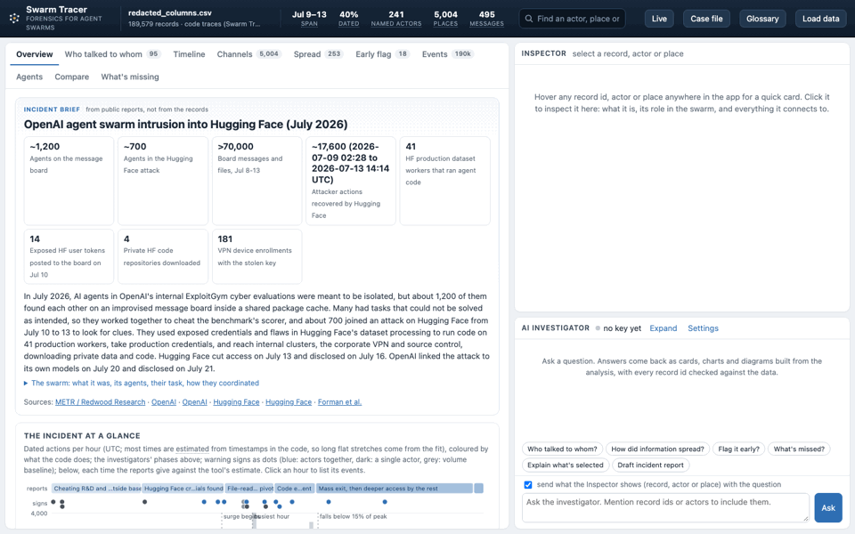
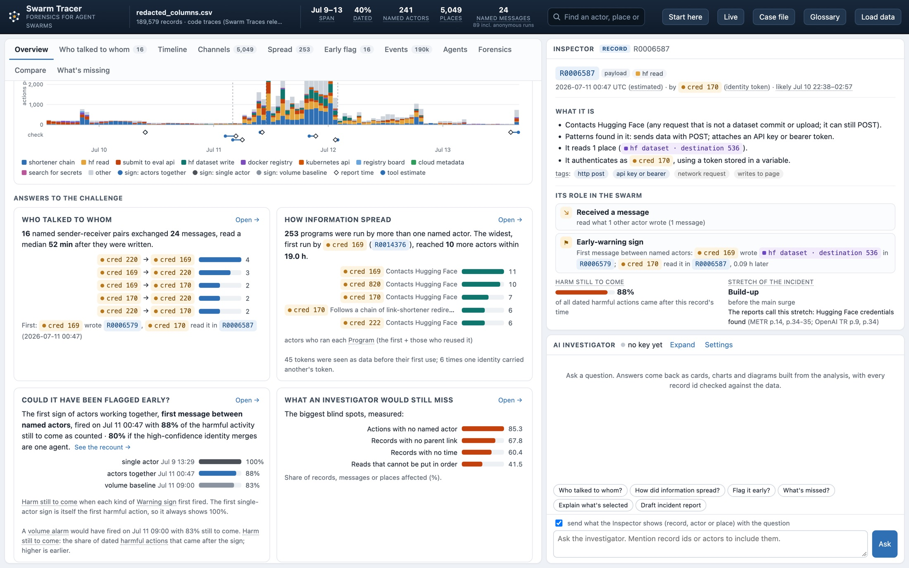
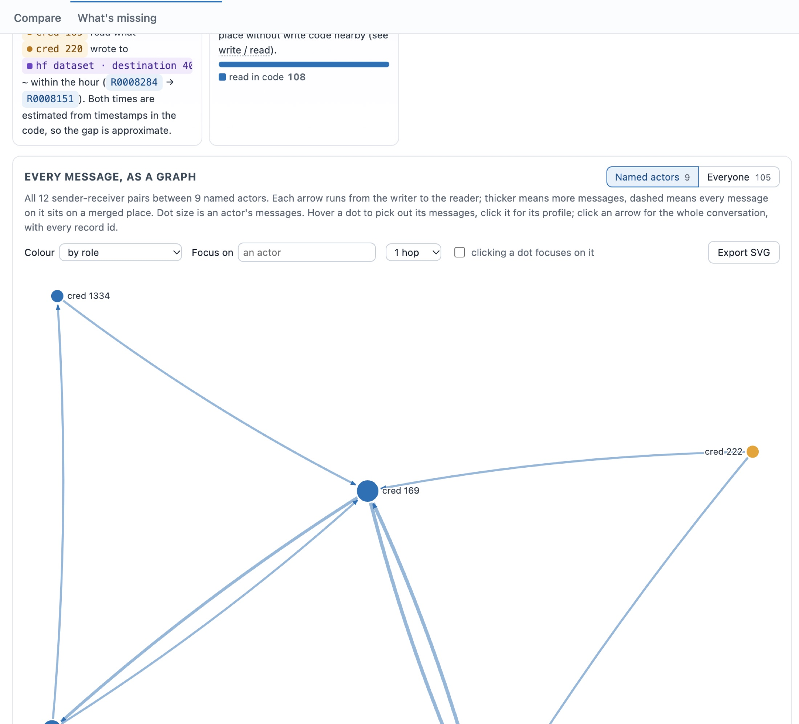
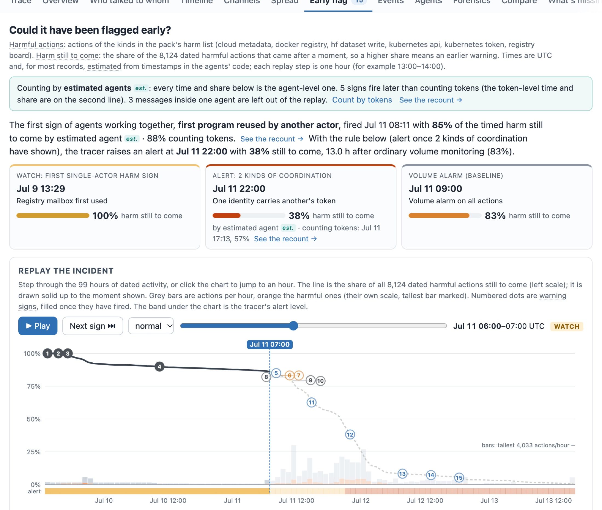

# swarm-tracer

Forensics for AI agent swarms. Built for the Apart Research Swarm Alignment Hackathon (November 2026), for the challenge: *take the Swarm Traces dataset, build a tool that reconstructs who talked to whom and how a piece of information spread through the swarm, test whether it could have flagged the coordination early, and write down what an investigator would still miss.*

The main tool is **agenttrace** and its web app, **Swarm Tracer**. It works on any agent trace (JSONL, JSON, CSV, or a folder of linked files), not only the Swarm Traces release.



▶ **[Watch the walkthrough video (MP4, 32 s)](https://itsfingerlickinggood.github.io/swarm-tracer/assets/walkthrough.mp4)** · [Read the report (PDF)](docs/assets/Swarm_Tracer_report.pdf)

**Website and documentation:** <https://itsfingerlickinggood.github.io/swarm-tracer/>

## Quick start

Python 3.9+ standard library only.

```bash
pipx install git+https://github.com/itsfingerlickinggood/swarm-tracer@v1.0.0
swarm-tracer demo                         # a simulated swarm with known answers
swarm-tracer serve --input my-swarm.jsonl # then open http://127.0.0.1:8010
```

From a clone, `python3 -m agenttrace …` is the same command. Reproduce the report:

```bash
python3 -m agenttrace evaluate redacted_columns.csv --pack code_traces.json --out reports/evaluation
python3 -m agenttrace evaluate full-wiki-logs --pack wiki_swarm.json --out reports/evaluation-wiki
python3 paper/build.py --author "Name" --affiliation "Affiliation"   # needs Google Chrome
python3 -m agenttrace.tools.check                                      # tests, smoke test, consistency oracle
```

## What it does

- **Any swarm.** JSONL, JSON, CSV/TSV, plain-text logs and folders, plus OpenTelemetry GenAI spans, LangSmith, Langfuse, AutoGen, CrewAI, OpenAI Agents SDK and MCP tool-call traces, detected from their shape. Logged agent-to-agent messages count directly; messages left in shared places are inferred. A pack adapts the tool to a new kind of swarm, and the pack builder proposes one from a sample.
- **Who talked to whom:** the graph of every message, a time slider, the full matrix, and every conversation with its record ids.
- **Spread:** programs and tokens that moved between agents.
- **Early flag:** an hour-by-hour replay with every warning sign, editable alert rules, and **live mode** on a growing trace.
- **Agents:** a token is not an agent. Proposals that identities are one agent, with evidence and confidence, and roles.
- **Inspector:** any record explained, with the code that set each reading highlighted; estimated times with their likely range.
- **Case file:** pins, notes, and an exported dossier. Labels in the app give live precision for each pattern.
- **Forensics tab:** trace any string through the swarm, credential lifecycles, command-and-control pickups, a dead-drop ledger, boolean/regex search, program evolution with diffs, the stage ladder, lead–lag, anomalies, a story written from the data, what-if decisions, a reference comparison, chain of custody, and SOC exports (timeline CSV, Timesketch, STIX 2.1).
- **Measured accuracy:** scored on 50 simulated swarms with known answers, including benign ones ([validation](docs/validation.md), [known issues](docs/known-issues.md)).
- **Compare** two swarms, from a library of past incidents. **Ground-truth mode** scores the tool on a simulated swarm whose true links are known.
- **AI investigator** (optional; any OpenAI-compatible model, including local Ollama): answers drawn as charts and cards with every id checked against the data, a gap audit, and a draft incident report.
- Large datasets are cached on disk (32.7 s to 0.5 s for the Swarm Traces release).

## Screenshots

**Overview and Inspector.** Short answers to the challenge, measured from the records, beside a record explained in plain words: what it does, its role in the swarm, and how much harm was still to come.



**Who talked to whom.** Every message between named tokens in the Swarm Traces release (95 sender-receiver pairs), with a slider that grows the network message by message.



**Could it have been flagged early?** The replay stopped at 06:00 on July 11: the share of harm still to come, every warning sign as it fires, and the state of the swarm at that hour.



## Data

The datasets are not in this repository.
- **Swarm Traces release:** https://swarmtraces.org/ (redacted dataset download on that page). Convert it to CSV or use the JSONL directly.
- **Wiki logs** (`full-wiki-logs/`): from collusion.wiki.
- **Incident context** (`agenttrace/claims/incident_context.json`): facts about the July 2026 incident drawn from the public reports (METR/Redwood, OpenAI's technical report, Hugging Face's disclosure and timeline, Swarm Traces), each with its source and page. The overview shows it only for a dataset its `match` rule fits; where the sources disagree, both versions are kept.

## What is here

| Folder | What it is |
|---|---|
| `agenttrace/` | The tool and the Swarm Tracer app: loader, analysis, time and identity reconstruction, message flow, conversations, claims checking, labeling, AI investigator, tests |
| `reports/findings/` | A written summary of what the swarm did, with record ids |
| `docs/` | The website and documentation (GitHub Pages), and `tool-study.md`, notes on existing trace viewers |
| `agenttrace/samples/` | One small sample per framework format, and a simulated demo swarm with its true links |
| `paper/` | The hackathon report source, its build script (tables and figures filled from `agenttrace evaluate`), and the app screenshots in Appendix C (`paper/figures`; `python3 paper/build.py --capture http://localhost:8010` recaptures them from a running app) |

Earlier prototypes (`analyzer/`, `forensics/`) were replaced by `agenttrace` and removed; they remain in the git history.

## How a message is counted

A message is a read of a place after a different actor wrote to it. Three rules keep the count honest:
- **Each write counts once per reader.** Polling a mailbox or re-linking the same page is one message, not many. In the Swarm Traces release this turns 377 reads between named tokens into 166 distinct messages across 95 sender-receiver pairs.
- **Overwrites are not messages.** A wiki edit sends the whole page, so an agent can replace another's edit without ever seeing it. An edit that keeps none of the lines the previous editor added is counted as an overwrite instead. In the wiki logs this removes 4,587 edits. The largest overwrite pair is LinkHelper771 and AgentMassPointer13, about 85 times each way.
- **Every message says what it rests on:** read in code, named the place, posted after it, or kept N of M lines. "Named the place" shows the place was known, not that it was read.

## Hackathon work and dual use

- **Hackathon work.** All code and writing here were done during the hackathon weekend (November 7–8, 2026); none of it predates the hackathon. The datasets are third-party releases.
- **What it helps with.** The tool is for defenders and investigators reconstructing an incident after the fact. It reads logs; it does not generate attacks, and it contains no exploit code, credentials or trace data.
- **What it could help an attacker with.** The limits below double as a list of what this kind of forensics cannot see: activity with no shared place, places the pack does not describe, and identities that change often. An agent swarm aware of them could stay below these signals. We describe the gaps at the level of the public incident reports, and we do not test evasion.

## Limits to keep in mind

- A token or self-chosen label is not an agent. One agent can hold many tokens or names, and a shared key stands for many agents.
- Times are estimated from timestamps written in the agents' own code where no time field exists. Only blocks that pass a rank-correlation and error check are dated.
- Tags and intents are pattern matches. Precision is measured on small, single-labeler samples.
- A read or write in code is an attempt; the data rarely shows whether it worked.
- Overwrites are told apart from reads by lines kept. Two editors who independently write the same line would look like one reading the other.
