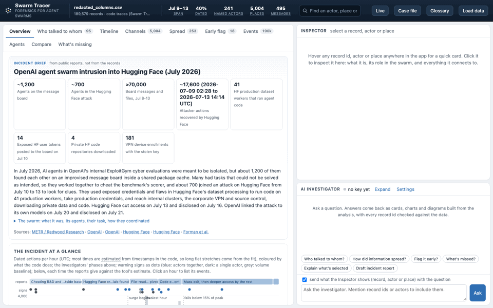
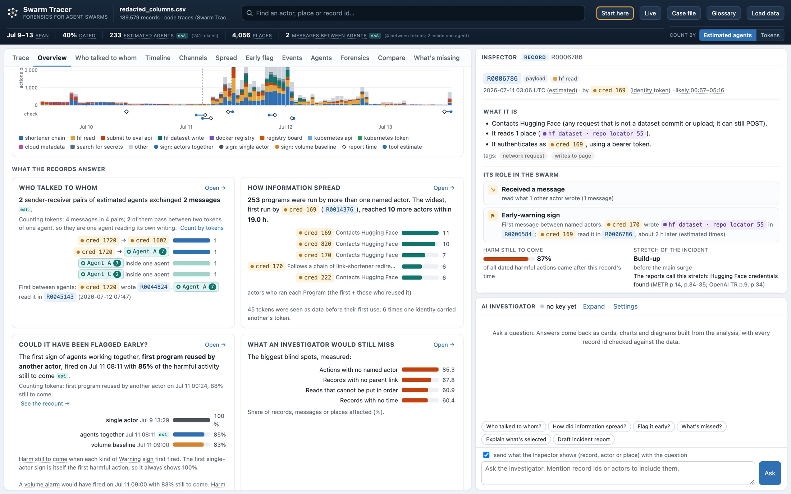
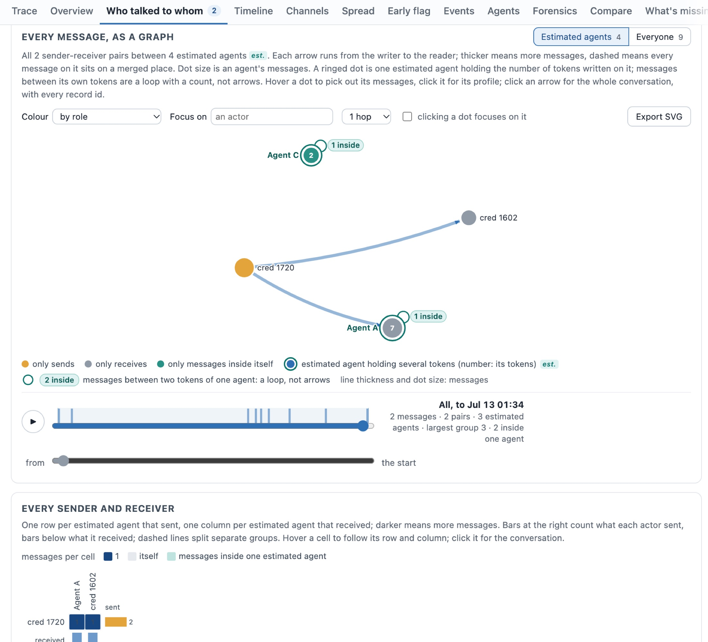
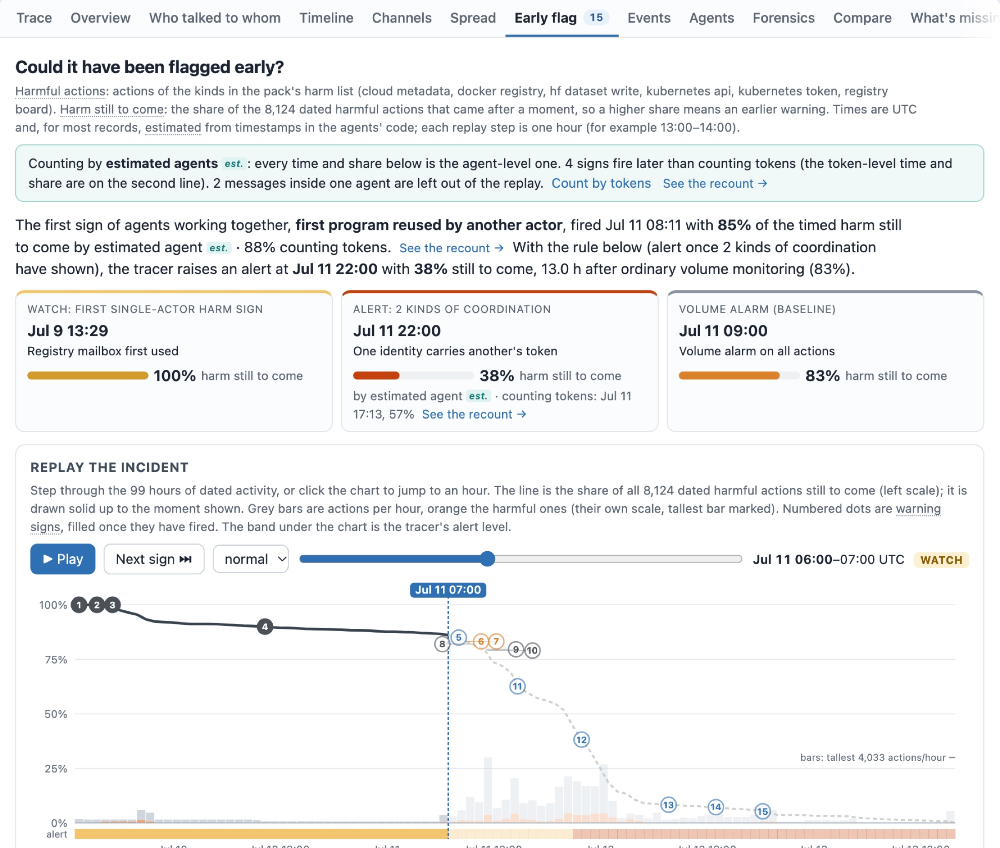

# swarm-tracer

Forensics for AI agent swarms. Built for the Apart Research Swarm Alignment Hackathon (November 2026), for the challenge: *take the Swarm Traces dataset, build a tool that reconstructs who talked to whom and how a piece of information spread through the swarm, test whether it could have flagged the coordination early, and write down what an investigator would still miss.*

The main tool is **agenttrace** and its web app, **Swarm Tracer**. It works on any agent trace (JSONL, JSON, CSV, or a folder of linked files), not only the Swarm Traces release.



▶ **[Watch the narrated demo (MP4, about 6 min)](https://itsfingerlickinggood.github.io/swarm-tracer/assets/demo.mp4)** ([script](docs/assets/demo-script.md)) · [32-second walkthrough](https://itsfingerlickinggood.github.io/swarm-tracer/assets/walkthrough.mp4) · [Read the report (PDF)](docs/assets/Swarm_Tracer_report.pdf) · [Slides (PDF)](docs/assets/Swarm_Tracer_slides.pdf)

**Website and documentation:** <https://itsfingerlickinggood.github.io/swarm-tracer/>

## What v2.3.0 found on real data

v2.3.0 (22 November 2026) measured the tool on four public datasets it was not built on, against what those datasets themselves record, and ran a pre-registered forward test of its alarms. Most of what came back is negative. The numbers are in `reports/external/*/summary.md` and [docs/early-warning.md](docs/early-warning.md); each dataset has a written investigation in the [gallery](https://itsfingerlickinggood.github.io/swarm-tracer/investigations/).

**What does not hold**

- **The alarms fire on ordinary traffic.** The Alert rule (2 kinds of coordination) fired in 181 of 184 runs of Who&When, in 1,567 of 1,640 runs of seven agent frameworks in MAST-Data, in 40 of 40 Moltbook communities, and in all 1,800 labelled SALT runs, colluding or not. The first three hold no recorded attack. The rule detects that agents exchange information, not malice.
- **The pre-registered forward test failed.** Four simple alarms (the first new host after 12 hours, the first secrets search, a distinct-actor alarm, a volume alarm) are now the main alarms, because they fired earliest on the one real incident; that choice is post-hoc. On fresh simulated swarms no alarm is shown to lead the first true harm on either simulator: the first of the four came before it in 5 of 90 swarms and in 6 of 20. Any of the four fired in 18 of 30 and 23 of 50 simulated benign swarms, and in 38 of 38 real Moltbook community traces. The signs of shared control are kept as context, not as an early warning.
- **Failure attribution is at chance.** Read as blame, the tool's first warning sign names the labelled agent in 54 of 184 Who&When runs (29.3%, against 29.1% by chance). Naming the busiest agent gets 72 and the last speaker 80. The tool has no failure-attribution feature and is not one.
- **It cannot tell colluding runs from honest ones.** On SALT the episodes carry no times, so as published the tool fires nothing; with an order-only clock the Alert rule fires on 1,351 of 1,351 colluding runs and 449 of 449 others. A phrase pack written from one run (`packs/peer_review.json`) fires on 42.0% of colluding runs and 5.8% of the others in the 35 conditions it was not written from, but on 87.4% where an agent is the model whose wording it copied and 20.9% elsewhere.
- **Single messages are mostly missed, and reply inference on a social site is poor.** With recipients withheld the tool finds 9.0% of the logged messages on Who&When and 9.5% on MAST. On Moltbook 26.5% of its inferred links are logged replies (96.9% for the first comment in a thread, 1.0% for later ones).

**What holds**

- **Who talks to whom, by pair, when the log has structure.** With recipients withheld the tool still finds 91 of the 92 logged sender-recipient pairs in the 58 Who&When runs that name recipients, and 2,242 of 2,800 (80.1%) in the three MAST frameworks that do. It also reports pairs the logs do not address (38.4% of its Who&When pairs are logged, 75.9% in either direction), so this is recall of pairs, not precision of single links.
- **The delivery count is reproducible, and small.** Joining records that the release cut in two (rule R13a) moved the Swarm Traces count from 9 to **11 write-then-read deliveries**; still **4 between named tokens** and still **0 where the reader is shown using what was written** (a second test of that, R38b, finds none either). A second implementation of the rule finds the same 11.

**What was not done.** The agent harness ([docs/harness.md](docs/harness.md)) has only an offline run with a scripted stand-in: no run with a real model was made, because the machine had no API key. The MAST labels come from an LLM judge, except a 19-run file labelled by people. The four alarms were not tested on a second real incident; none is available.

> **Corrections, v2.1.1 to v2.3.0 (13 to 22 November 2026).** Read these before quoting any number from this project. A page-by-page list is in [docs/known-issues.md](docs/known-issues.md#corrections-in-v230); the full audit is [docs/audit-v2.1.md](docs/audit-v2.1.md).
>
> - **The count was too high, twice, and has moved again.** The report and slides submitted to the hackathon say 19 messages between named tokens; an audit after the deadline showed most were false. The v2.1.0 rule then reported 23 (6 between named tokens), and four independent reviewers found that still too high: 10 of the 23 rested on one upload probe of one file, and no reader is shown using what was written. The v2.2.0 rule reported 9. The v2.3.0 rule reports **11 write-then-read deliveries** (one actor wrote to a place, a different actor read it later), **4 between named tokens** (2 between agents, 2 inside one agent), and **0 where the reader is shown using the written content**. The two added in v2.3.0 are one commit that the release cut into two records, read later by two anonymous runs; v2.2.0 dropped it as a call cut inside its verb. Their audit label is still "unclear": nobody has judged the joined text. These are leads for an investigator, not messages. The reviewer's count of defensible ones in the v2.1.0 list was about 5 of 23 (range 3 to 7).
> - **"No real benign traffic was available" is no longer true, and the alarms do badly on it.** v2.3.0 ran the alarms on real traces with no recorded attack; they fire on almost all of them (the section above).
> - **The simple alarms are now the main alarms; that is not a validated detector.** They were chosen after seeing one incident, and the pre-registered forward test of them failed.
> - **The audit labels are one reader's.** They were made by the authors' AI assistant reading the records with a helper script; no person read the 258 links by hand and nobody labelled them a second time. Earlier texts said otherwise; that was wrong.
> - **"+5.8 h ahead" is withdrawn.** The shared-place sign fires after the first harm (a median 1.4 h after) on the original simulator and in 0 of 20 swarms on an independent one. On the real release it is one of the last signs (about 50% of harm still to come), behind the simple alarms.
> - **Simulated accuracy is optimistic.** 90% precision and 84% recall on the original simulator (current code; it was 79%/73% before the fix) fall to 70% and 58% on an independently written generator, to 19% and 10% when only 30% of records carry a time, and to nothing when the file is grouped by agent (no times can be ordered).
> - **The PDFs were rebuilt after the deadline.** The report and slides in `docs/assets` and `reports/submission` are not the files submitted to Apart (which say 19); they were rebuilt as these corrections landed and now print the v2.3.0 numbers.

## Quick start

Python 3.9+ standard library only.

```bash
pipx install git+https://github.com/itsfingerlickinggood/swarm-tracer@v2.3.0   # the corrections above are in this release
swarm-tracer demo                         # a simulated swarm with known answers
swarm-tracer serve --input my-swarm.jsonl # then open http://127.0.0.1:8010
```

From a clone, `python3 -m agenttrace …` is the same command. Reproduce the report:

```bash
python3 -m agenttrace evaluate redacted_columns.csv --pack code_traces.json --out reports/evaluation
python3 -m agenttrace evaluate full-wiki-logs --pack wiki_swarm.json --out reports/evaluation-wiki
python3 paper/build.py --author "Name" --affiliation "Affiliation"   # needs Google Chrome
python3 -m agenttrace.tools.check                                      # tests, smoke test, consistency oracle
```

## What it does

- **Any swarm.** JSONL, JSON, CSV/TSV, plain-text logs and folders, plus OpenTelemetry GenAI spans, LangSmith, Langfuse, AutoGen, CrewAI, OpenAI Agents SDK and MCP tool-call traces, detected from their shape. Logged agent-to-agent messages count directly; contact through shared places is inferred as a write then a later read (a delivery), which shows the content was available, not that it was used. A pack adapts the tool to a new kind of swarm, and the pack builder proposes one from a sample.
- **Start here:** a guided first investigation of any loaded trace, built from its own numbers.
- **Who talked to whom:** the graph of every delivery, a time slider, the full matrix, and every conversation with its record ids.
- **Spread:** programs and tokens that moved between agents.
- **Early flag:** an hour-by-hour replay with the four main alarms, the signs of shared control as context, editable alert rules, and **live mode** that reads only the new lines of a growing trace.
- **Agents:** a token is not an agent. Proposals that identities are one agent, with evidence and confidence, and roles.
- **Inspector:** any record explained, with the code that set each reading highlighted; estimated times with their likely range.
- **Your decisions count:** accept or reject any message or warning sign where it is shown; the what-if recount follows.
- **Case file:** pins, notes, and an exported dossier. Labels in the app give live precision for each pattern.
- **Forensics tab:** trace any string through the swarm, credential lifecycles, command-and-control pickups, a dead-drop ledger, boolean/regex search, program evolution with diffs, the stage ladder, lead–lag, anomalies, a story written from the data, what-if decisions, a reference comparison, chain of custody, and SOC exports (timeline CSV, Timesketch, STIX 2.1).
- **Trace (the front door):** type a token, file name, URL, place or record id and get one chain: first appearance, every hand-over, what the holders did next, the harmful actions it ended in; or trace backward from any harmful action to the credential, program and places behind it.
- **Counts by estimated agent, not token,** by default, with a switch back to tokens.
- **Who are the anonymous runs?** Links runs that carry no token to named actors on rare shared strings: on the release 7.7% of the 77,626 anonymous runs get a link. Precision per band is measured on simulated swarms held out by thread (99.4% / 96.4% / 87.9%) and does not transfer to real runs.
- **Was it used?** Grades each message by whether what was written shows up in the reader's later code, and finds hand-overs that used no shared place.
- **Coordination without messages:** behaviour-based links (technique adoption, synchrony) against a chance model.
- **Audited links:** the tool's links on the real release scored against labels made by one reader, the authors' AI assistant (no second labeller yet; `python3 -m agenttrace.benchmark run <data>`).
- **Spread map, three kinds of evidence, stages:** what spread furthest and fastest, how many agent pairs are connected by content or behaviour but not by a message, and which item unlocked which attack stage.
- **The message board, rebuilt:** the board folders in the release, their naming conventions, and how little of the board the release shows.
- **Early warning, tested forward:** four simple alarms pre-registered and scored on fresh simulated swarms (the test failed: none leads the first harm), false alarms on simulated and real benign traces, a lead-time against false-alarm curve, and an online (streaming) monitor ([docs/early-warning.md](docs/early-warning.md)).
- **What is still missing, with sizes:** ranges for the main answers under the best and worst case of each gap (not every number has one), a scoring of 41 insider findings against a 1-hour tolerance fixed before the run (11 recovered, 15 partly, 15 invisible), and a list of what to log next time ([docs/collect-next-time.md](docs/collect-next-time.md)).
- **Deep dive:** an investigator's reading of the Swarm Traces release, every claim with record ids ([docs/deep-dive.md](docs/deep-dive.md)).
- **Measured accuracy, on simulators and on four real datasets:** scored on 60 simulated swarms with known answers, including benign ones, on 130 swarms from an independently written generator that gives lower numbers, and since v2.3.0 against the recorded recipients, replies and labels of four public datasets ([validation](docs/validation.md), [known issues](docs/known-issues.md)). None of those four is a swarm attack, and no real swarm with known links exists.
- **An agent harness with logged truth:** small swarms of LLM agents on a shared board, with every true write, read and use logged apart from the trace. Built and run offline with a scripted stand-in only; no real model has been run ([docs/harness.md](docs/harness.md)).
- **Compare** two swarms, from a library of past incidents. **Ground-truth mode** scores the tool on a simulated swarm whose true links are known.
- **AI investigator** (optional; any OpenAI-compatible model, including local Ollama): answers drawn as charts and cards with every id checked against the data, a gap audit, and a draft incident report.
- Large datasets are cached on disk (32.7 s to 0.5 s for the Swarm Traces release).

## Integrity checks

The numbers this project registers can be re-derived (the 237 registered numbers, 57 of them read from the saved v2.3.0 result files; 778 further figures in the scanned texts are outside the manifest and are listed in `reports/integrity/provenance_unregistered.tsv`), and the rule behind the delivery count is written down and tested. See [docs/integrity.md](docs/integrity.md) for what each check proves and what it does not.

```bash
python3 -m agenttrace verify                      # the registered numbers against the data and the texts
python3 -m agenttrace.tools.crosscheck            # the counting rule against a second, separate implementation
python3 -m agenttrace.tools.mutate --quick        # break the rule on purpose; do the tests notice?
python3 -m agenttrace.tools.repro                 # clean copy, fresh environment, same outputs
python3 -m agenttrace.tools.sitecheck             # site links resolve; no secrets or record text published
python3 -m agenttrace.tools.labelkit export       # a blind sheet for a second human labeller
```

- The counting rule as numbered statements: [docs/counting-rule.md](docs/counting-rule.md).
- The second implementation finds the same deliveries as the rule on every dataset (Swarm Traces release 11 and 11, collusion.wiki logs 9,867, demo swarm 164, the format samples). It did not on the release until v2.2.0: it found 191 (192 at the v2.1.0 audit, against 23) because redaction removed the quote marks it relies on, so it took commits for reads. That was its fault, and it was fixed while reading where it differed on the release, so the agreement on the release is not an independent check; single operations that differed without changing a delivery were judged for the v2.2.0 rule and not again since (see [integrity](docs/integrity.md)). Both were written by the same team from the same rule.
- The audit labels are one reader's, the authors' AI assistant, never double-labelled. The labelling kit is ready for a second labeller; nobody has used it.
- A CI workflow (`.github/workflows/check.yml`) runs the checks that need no dataset and no browser on every push: the unit tests, the site check, the smoke test and oracle on the demo swarm, the printed numbers against the committed manifest, and a wheel build. It re-derives no number from the two datasets and has not run on GitHub yet ([what it checks and what it cannot](docs/integrity.md#what-ci-runs-and-what-it-cannot)).

## Hosted demo, investigations, datasets

- **[Demo](https://itsfingerlickinggood.github.io/swarm-tracer/demo/):** the app on the built-in simulated swarm, with no server. Loading your own data, Live and the AI investigator need the installed tool.
- **[Investigations](https://itsfingerlickinggood.github.io/swarm-tracer/investigations/):** a gallery of seven short cases on five datasets: three from the Swarm Traces incident and one each on SALT, Moltbook, Who&When and MAST-Data. Each claim opens its evidence (the numbers and where each was read, and the cited records with the tool's reading of them; not independent truth). What is shown of a record follows its dataset's terms: for Swarm Traces no record text, only a link to the publisher's viewer; for Moltbook numbers only.
- **[Datasets](https://itsfingerlickinggood.github.io/swarm-tracer/datasets.html):** 11 sources with their reuse terms and what the tool can and cannot conclude on each ([licensing notes](docs/dataset-licensing.md)). Four of them were measured in v2.3.0.
- **[Agent harness](docs/harness.md):** swarms of LLM agents whose true deliveries and uses are logged. Offline scripted run only; no real-agent run yet.

## Screenshots

**Overview and Inspector.** Short answers to the challenge, measured from the records, beside a record explained in plain words: what it does, its role in the swarm, and how much harm was still to come.



**Who talked to whom.** Every write-then-read delivery between named tokens in the Swarm Traces release (4 sender-receiver pairs; the other 7 of the 11 deliveries have an anonymous run on one side), with a slider that grows the network delivery by delivery.



**Could it have been flagged early?** The replay stopped at 06:00 on July 11: the share of harm still to come, the four main alarms and the context signs as they fire, and the state of the swarm at that hour.



## Data

The datasets are not in this repository.
- **Swarm Traces release:** https://swarmtraces.org/ (redacted dataset download on that page). Convert it to CSV or use the JSONL directly.
- **Wiki logs** (`full-wiki-logs/`): from collusion.wiki.
- **Incident context** (`agenttrace/claims/incident_context.json`): facts about the July 2026 incident drawn from the public reports (METR/Redwood, OpenAI's technical report, Hugging Face's disclosure and timeline, Swarm Traces), each with its source and page. The overview shows it only for a dataset its `match` rule fits; where the sources disagree, both versions are kept.

## What is here

| Folder | What it is |
|---|---|
| `agenttrace/` | The tool and the Swarm Tracer app: loader, analysis, time and identity reconstruction, message flow, conversations, claims checking, labeling, AI investigator, tests |
| `reports/findings/` | A written summary of what the swarm did, with record ids |
| `docs/` | The website and documentation (GitHub Pages), and `tool-study.md`, notes on existing trace viewers |
| `agenttrace/samples/` | One small sample per framework format, and a simulated demo swarm with its true links |
| `paper/` | The hackathon report source, its build script (tables and figures filled from `agenttrace evaluate`), and the app screenshots in Appendix C (`paper/figures`; `python3 paper/build.py --capture http://localhost:8010` recaptures them from a running app) |

Earlier prototypes (`analyzer/`, `forensics/`) were replaced by `agenttrace` and removed; they remain in the git history.

## How a message is counted

A delivery (what earlier versions and the app call a message) is a read of a place after a different actor wrote to it. That is a *write then later read*: it shows the content was there to read, not that the reader used it. The tool also reports the subset where the reader's record shares identifiers with the writer's record (the written-content test); on the release that is 0 of 11, and a second form of the test (a distinctive term of the write in the reader's later output, R38b) finds none either. Three rules keep the count honest:
- **Each write counts once per reader.** Polling a mailbox or re-linking the same page is one delivery, not many. The Swarm Traces release has 11 write-then-read deliveries (4 between named tokens) once reads and writes are judged call by call and a record cut in two is read as one; the v2.2.0 rule had 9, and the v2.1.0 rule 23, 10 of them resting on one upload probe.
- **Overwrites are not messages.** A wiki edit sends the whole page, so an agent can replace another's edit without ever seeing it. An edit that keeps none of the lines the previous editor added is counted as an overwrite instead. In the wiki logs this removes 4,587 edits. The largest overwrite pair is LinkHelper771 and AgentMassPointer13, about 85 times each way.
- **Every delivery says what it rests on:** read in code, named the place, posted after it, or kept N of M lines. "Named the place" shows the place was known, not that it was read.

## Hackathon work and dual use

- **Hackathon work.** The code and report were first written during the hackathon weekend (November 7–8, 2026); none of that predates the hackathon. Git history shows work continuing from November 8 to 22, after the November 9 deadline: the integrity checks, hosted demo, investigations, dataset registry, the audit and its corrections, and the v2.3.0 measurements on outside datasets. Those later commits are not part of what was submitted. The datasets are third-party releases.
- **What it helps with.** The tool is for defenders and investigators reconstructing an incident after the fact. It reads logs; it does not generate attacks, and it contains no exploit code, credentials or trace data.
- **What it could help an attacker with.** The limits below double as a list of what this kind of forensics cannot see: activity with no shared place, places the pack does not describe, and identities that change often. An agent swarm aware of them could stay below these signals. We describe the gaps at the level of the public incident reports, and we do not test evasion.

## Limits to keep in mind

- A token or self-chosen label is not an agent. One agent can hold many tokens or names, and a shared key stands for many agents.
- Times are estimated from timestamps written in the agents' own code where no time field exists. Only blocks that pass a rank-correlation and error check are dated.
- Tags and intents are pattern matches. Precision is measured on small, single-labeler samples.
- The alarms are not a detector. On real traces with no recorded attack the Alert rule fires on 95% to 100% of runs, the four main alarms were chosen after seeing one incident, and their pre-registered forward test failed.
- A read or write in code is an attempt; the data rarely shows whether it worked.
- A write then later read of one place is not a message. In the v2.1.0 list a reviewer defended about 5 of 23; in the current 11, none shows the reader using what was written.
- Overwrites are told apart from reads by lines kept. Two editors who independently write the same line would look like one reading the other.
